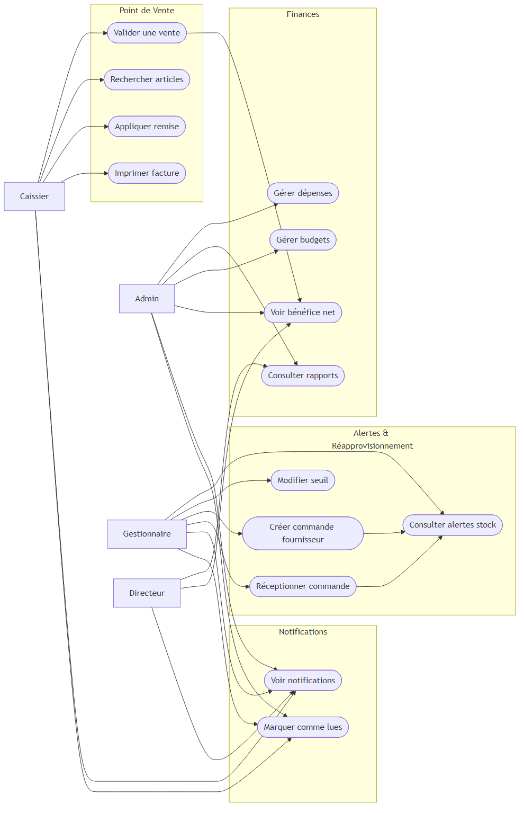
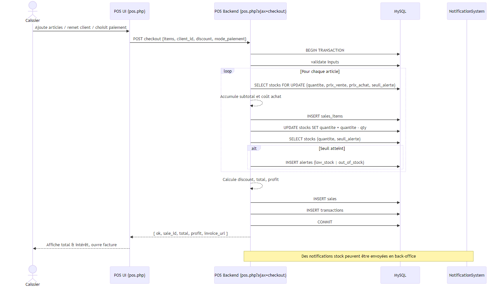
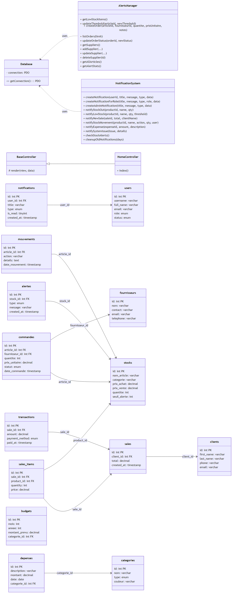

How to generate the Word document with diagrams

Prerequisites (Windows):
- Install Graphviz (adds dot to PATH)
- Install Node.js (optional) or ensure Mermaid CLI available
- Install mermaid-cli: npm i -g @mermaid-js/mermaid-cli
- Install pandoc: https://pandoc.org/installing.html

Steps:
1) Generate PNGs from Mermaid files:
   mmdc -i use-cases.mmd -o use-cases.png
   mmdc -i sequence-pos-checkout.mmd -o sequence-pos-checkout.png
   mmdc -i classes.mmd -o classes.png

2) Create a simple markdown that embeds images, then convert to Word:
   Create file diagrams.md with:

   # Scolaria - Diagrammes
   ## Cas d'utilisation
   

   ## Séquence - POS Checkout
   

   ## Diagramme de classes
   

   Then run:
   pandoc diagrams.md -o diagrams.docx

You will get diagrams.docx containing the three diagrams.

