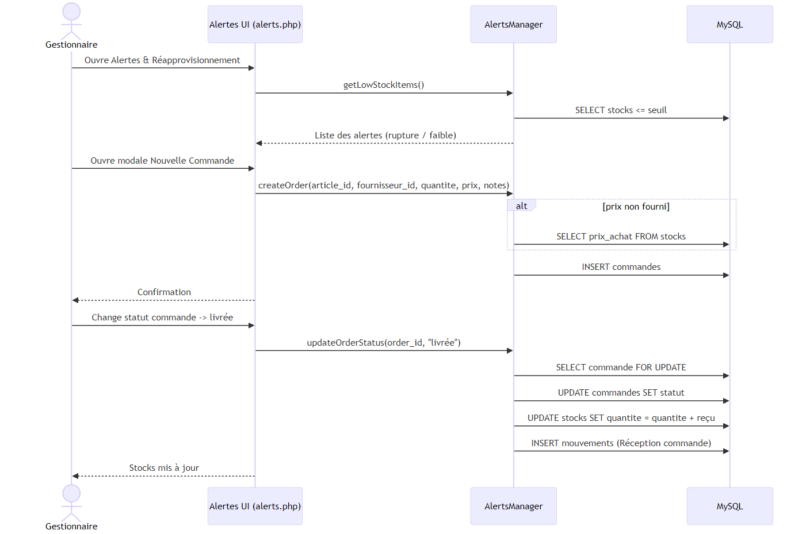

# Scolaria - Diagrammes

## Cas d'utilisation

Objectif:
- Donner une vue d'ensemble des fonctionnalités clés par rôle.

Points clés:
- Acteurs: Admin, Gestionnaire, Caissier, Directeur.
- Modules: POS (vente), Alertes & Réapprovisionnement, Finances, Notifications.
- Liaisons importantes: la vente (checkout) alimente les rapports et le bénéfice net; le réapprovisionnement impacte les alertes de stock.

## Séquence - POS Checkout

Objectif:
- Décrire le processus de vente côté caisse (`pos.php`) jusqu'à l'enregistrement en base.

Flux principal:
- Le caissier prépare le panier et soumet un POST de checkout.
- Le backend ouvre une transaction, verrouille les lignes de stock, insère `sales_items`, met à jour les quantités et enregistre `sales` et `transactions`.
- Retourne le récapitulatif (total, profit, lien facture) et peut déclencher des alertes de seuil.

Décisions/erreurs:
- Seuil d'alerte atteint: création d'une alerte.
- Toute erreur interrompt et annule la transaction (via ROLLBACK implicite si non commit).

## Séquence - Réapprovisionnement fournisseur

Objectif:
- Montrer la création et la réception d'une commande fournisseur suite aux alertes de stock.

Flux principal:
- Le gestionnaire consulte les alertes, crée une commande, puis réceptionne.
- Les quantités de `stocks` sont mises à jour, et les alertes ajustées.

## Diagramme de classes

Objectif:
- Visualiser les entités principales et leurs relations.

Points clés:
- Entités typiques: `users`, `stocks`, `sales`, `sales_items`, `transactions`, `alertes`, `fournisseurs` (selon le modèle).
- Relations: une vente possède plusieurs lignes (`sales_items`); `stocks` est impacté par les ventes et les réceptions; `users` portent un rôle.

Remarque:
- Les noms exacts de tables/colonnes peuvent varier; voir le schéma SQL pour le détail.

## Séquence - Authentification

Objectif:
- Expliquer comment l'utilisateur s'authentifie, comment les rôles contrôlent l'accès et comment se passe la déconnexion.

Flux principal:
- Login (`login.php`): vérifie l'utilisateur en base, initialise la session et redirige selon le rôle.
- Garde (`config/auth.php`): `require_login()` protège les pages; `require_roles([...])` applique les autorisations et redirige vers `access_denied.php` si nécessaire.
- Logout (`logout.php`): vide la session, supprime le cookie et redirige vers la page de connexion.
- Inscription (`register.php`): crée un utilisateur avec `password_hash`, en validant l'unicité `username`/`email`.

Notes sécurité:
- Cookies de session `httponly`, `samesite=Lax`, option `secure` activée si HTTPS.
- `session_regenerate_id(true)` après connexion.

